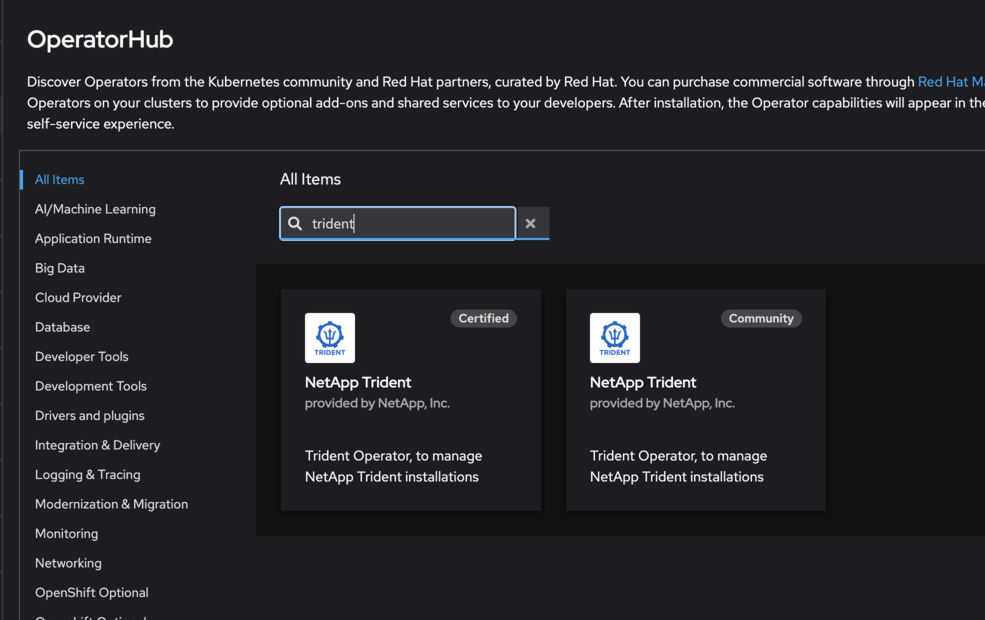
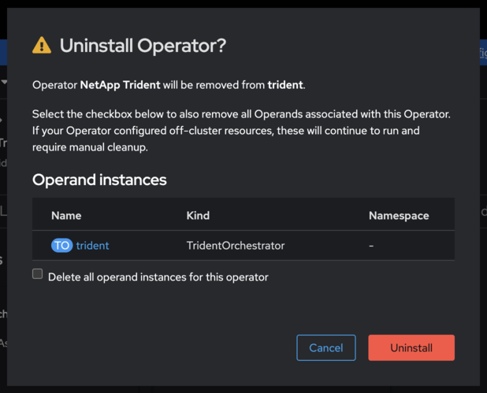

= 切換到 OpenShift 認證的 Trident 操作員
:hardbreaks:
:allow-uri-read: 
:icons: font
:imagesdir: ../media/

[role="lead"]
您可以從社群版 Operator、基於 Helm 的安裝或手動部署的 Operator 切換到 Red Hat OpenShift 認證的 Trident Operator。每種方法的過程都包括卸載現有 Operator，然後使用 OperatorHub 安裝認證的 Operator。

.開始之前
在開始安裝之前，link:../trident-get-started/requirements.html["為 Trident 安裝準備環境"]。

IMPORTANT: 在卸載過程中請勿刪除 `TridentOrchestrator`自訂資源（CR）。 `TridentOrchestrator` CR 會保留您的後端和儲存類別配置，這在安裝認證操作員後是必要的。

[[switch-from-the-community-operator]]
== 從社群營運商切換

.步驟
. 使用 OpenShift 控制台導航到 OperatorHub。
+

. 找到 NetApp Trident 社群操作員。
+

+

WARNING: 不要選擇 *Delete all operand instances from this operator*。

. 按一下 *Uninstall* 。
. 卸載完成後，繼續執行 <<install-certified,安裝 OpenShift 認證操作員>>。

[[switch-from-a-helm-based-operator-installation]]
== 從基於 Helm 的操作員安裝切換

.步驟
. 列出您的 Trident 安裝所使用的 Helm 版本：
+
[listing]
----
helm ls -n trident
----
. 解除安裝 Helm 版本：
+
[listing]
----
helm uninstall <release-name> -n trident
----
. 卸載完成後，繼續執行 <<install-certified,安裝 OpenShift 認證操作員>>。

[[switch-from-a-manually-deployed-operator]]
== 從手動部署的 operator 切換

如果您是透過 `bundle.yaml`安裝程式套件中的檔案手動部署操作員來安裝 Trident，請透過刪除相同的資訊清單來移除。

.步驟
. 使用套件組合資訊清單刪除操作員部署：
+
[listing]
----
kubectl delete -f deploy/bundle.yaml -n trident
----
. 卸載完成後，繼續執行 <<install-certified,安裝 OpenShift 認證操作員>>。

[[install-the-openshift-certified-operator]]
[[install-certified]]
== 安裝 OpenShift 認證操作員

.步驟
. 導航至 Red Hat OperatorHub。
. 搜尋並選擇 NetApp Trident Operator。
+

. 請依照螢幕上的指示安裝 operator。

[[verification]]
== 驗證

* 檢查控制台中的 OperatorHub，確保新認證的操作員已成功安裝。

