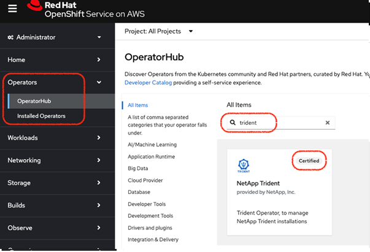
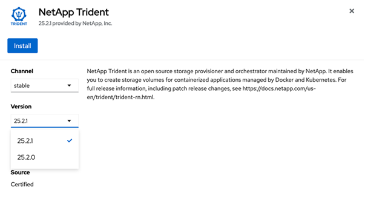
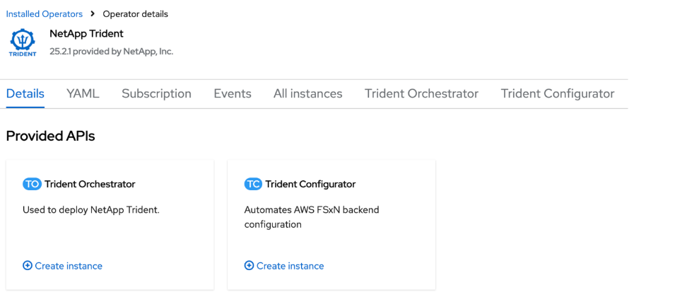

= 使用 OpenShift OperatorHub 安裝 Trident
:hardbreaks:
:allow-uri-read: 
:icons: font
:imagesdir: ../media/

[role="lead"]
如果您使用 Red Hat OpenShift，則可以使用 Red Hat 認證的操作員來安裝 NetApp Trident。請依照以下步驟從 Red Hat OpenShift Container Platform 安裝 Trident。

.開始之前
在開始安裝之前，link:../trident-get-started/requirements.html["為 Trident 安裝準備環境"]。

[[find-and-install-the-trident-operator]]
== 找到並安裝 Trident 操作員

.步驟
. 導航至 OpenShift OperatorHub 並搜尋 NetApp Trident。
+

. 點選 *NetApp Trident* 開啟安裝設定。
. 選擇所需選項，然後按一下 *Install* 以開啟 Operator 配置。
+

+

NOTE: 請確保選擇最新版本的 Operator。

. 保留所有參數不變，然後點選 *Install* 。
+
image::../media/openshift-operator-03.png[安裝]

. 點擊 *View Operator* 查看 Operator 的詳細資料。
+

. 點擊 *YAML view* 並將以下內容貼到表單中：
+
[source, yaml]
----
apiVersion: trident.netapp.io/v1
kind: TridentOrchestrator
metadata:
  name: trident
  namespace: openshift-operators
spec:
  IPv6: false
  debug: false
  nodePrep:
  - iscsi
  imageRegistry: ''
  k8sTimeout: 180s
  namespace: trident
  silenceAutosupport: false
----
+
[NOTE]
====
UI 提供預設範例。您可以直接編輯，而無需複製完整組態。

====

[NOTE]
====
選用：啟用並行

若要啟用並行性，請在規格中新增下列欄位：

[source, yaml]
----
enableConcurrency: true
----
====
[NOTE]
====
* Red Hat Enterprise Linux CoreOS （RHCOS） 未啟用和設定 iSCSI。
* 您可以新增  `nodePrep` 參數，以在所有 OpenShift 工作節點上設定和啟用 iSCSI 和多路徑服務。
* 從 OpenShift 4.19 版本開始，此功能支援的最低 Trident 版本為 25.06.1。

====
. 點選 *Create*；Trident Orchestrator 將會完全安裝。
+
image::../media/openshift-operator-08.png[已安裝]

[[uninstall-trident-operator]]
== 卸載 Trident 操作員

.步驟
. 從已安裝的運算子清單中選擇 Trident 運算子。
. 選擇是否要從運算子中刪除所有操作數實例。
+

WARNING: 如果您沒有選取「從該運算子中刪除所有運算元實例」複選框，則不會卸載 Trident。

. 按一下 *Uninstall* 。

