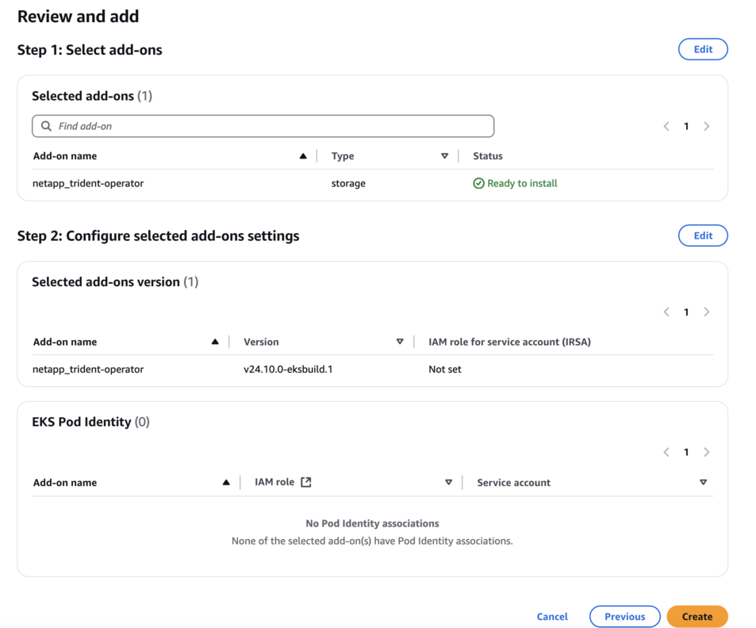
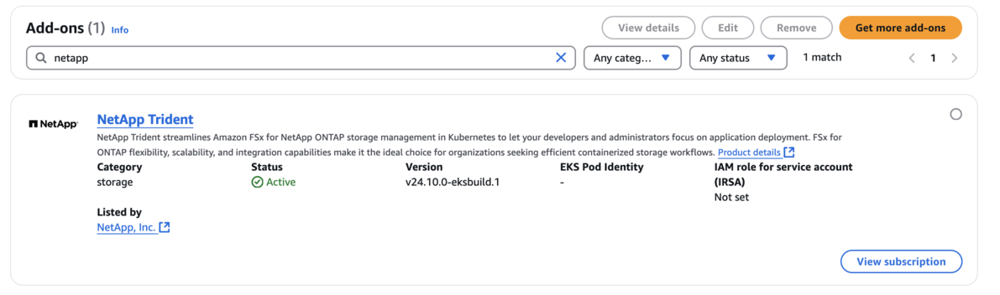

= 在 EKS 叢集上設定 Trident EKS 附加元件
:hardbreaks:
:allow-uri-read: 
:icons: font
:imagesdir: ../media/

[role="lead"]
NetApp Trident 簡化了 Kubernetes 中 Amazon FSx for NetApp ONTAP 儲存的管理，讓您的開發人員和管理員能夠專注於應用程式部署。NetApp Trident EKS 外掛程式包含最新的安全性修補程式和錯誤修復，並經過 AWS 驗證，可與 Amazon EKS 搭配使用。EKS 附加元件可讓您持續確保 Amazon EKS 叢集的安全性和穩定性，並減少安裝、設定和更新附加元件所需的工作量。

[[prerequisites]]
== 先決條件

在為 AWS EKS 設定 Trident 附加元件之前，請確保您已具備以下條件：

* 具有使用附加元件權限的 Amazon EKS 叢集帳戶。請參閱 link:https://docs.aws.amazon.com/eks/latest/userguide/eks-add-ons.html["Amazon EKS 附加元件"^]。
* AWS 對 AWS Marketplace 的權限：
`"aws-marketplace:ViewSubscriptions",
"aws-marketplace:Subscribe",
"aws-marketplace:Unsubscribe`
* AMI 類型：Amazon Linux 2（AL2_x86_64）或 Amazon Linux 2 Arm（AL2_ARM_64）
* 節點類型：AMD 或 ARM
* 現有的 Amazon FSx for NetApp ONTAP 檔案系統

[[steps]]
== 步驟

. 請務必建立 IAM 角色和 AWS 密鑰，以使 EKS Pod 能夠存取 AWS 資源。如需相關指示，請參閱 link:../trident-use/trident-fsx-iam-role.html["建立 IAM 角色和 AWS Secret"^]。
. 在 EKS Kubernetes 叢集上，導覽至 *Add-ons* 標籤。
+
image::../media/aws-eks-01.png[EKS 叢集附加元件選項卡]

. 前往 *AWS Marketplace 外掛程式*，然後選擇 _storage_ 類別。
+
image::../media/aws-eks-02.png[AWS Marketplace 附加元件儲存類別]

. 找到 *NetApp Trident*，選取 Trident 外掛程式的複選框，然後按一下 *Next*。
. 選擇所需的附加元件版本。
+
image::../media/aws-eks-03.png[Trident 附加元件版本選擇]

. 配置所需的附加元件設定。
+

. 如果您正在使用 IRSA （服務帳戶的 IAM 角色），請參閱其他組態步驟link:https://docs.netapp.com/us-en/trident/trident-use/trident-fsx-install-trident.html#enable-the-trident-add-on-for-aws["這裡"]。
. 選取 *建立*。
. 確認附加元件的狀態為 _Active_ 。
+

. 執行以下命令以驗證 Trident 是否已正確安裝在叢集上：
+
[listing]
----
kubectl get pods -n trident
----
. 繼續進行設定並配置儲存後端。如需相關資訊，請參閱 link:trident-fsx-storage-backend.html["配置儲存後端"]。

[[installuninstall-the-trident-eks-add-on-using-cli]]
== 使用 CLI 安裝/解除安裝 Trident EKS 附加元件

.使用 CLI 安裝 NetApp Trident EKS 外掛程式：
以下範例指令安裝 Trident EKS 外掛程式：
`eksctl create addon --cluster clusterName --name netapp_trident-operator --version v25.6.0-eksbuild.1`（使用專用版本）

以下範例指令安裝 Trident EKS 外掛程式版本 25.6.1：
`eksctl create addon --cluster clusterName --name netapp_trident-operator --version v25.6.1-eksbuild.1`（使用專用版本）

以下範例指令安裝 Trident EKS 外掛程式版本 25.6.2：
`eksctl create addon --cluster clusterName --name netapp_trident-operator --version v25.6.2-eksbuild.1`（使用專用版本）

.使用 CLI 卸載 NetApp Trident EKS 外掛程式：
以下命令會解除安裝 Trident EKS 附加元件：

[listing]
----
eksctl delete addon --cluster K8s-arm --name netapp_trident-operator
----